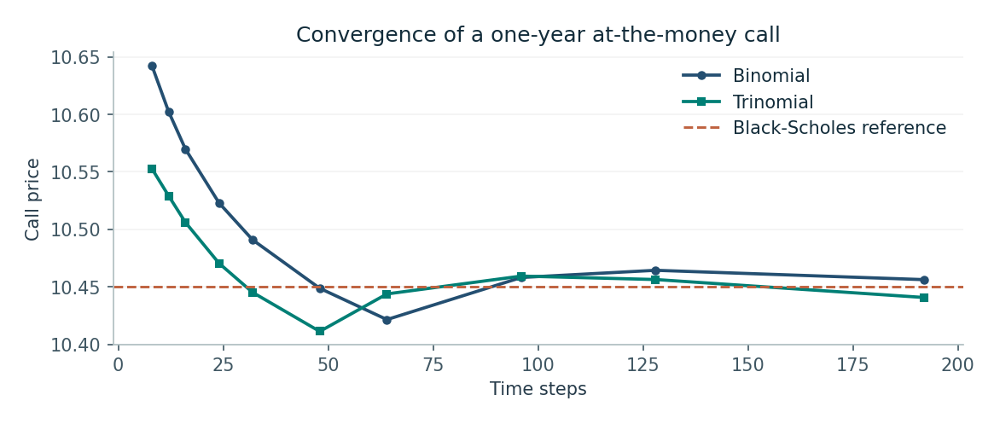

# LatticeLab

LatticeLab prices the same option in Python and Excel VBA. The side-by-side view makes it possible to tell whether a difference comes from the tree resolution, the contract terms or the implementation.

## Try an experiment

Start with a European call and refine the binomial grid. Compare its price with the trinomial result. Then switch to an American put, introduce a discrete dividend and inspect how the exercise decision and hedge change. The interface also supports digital payoffs, portfolios of signed positions and sensitivity analysis.

## How it works

The chart uses a one-year European call with spot and strike at 100, volatility at 20 percent, a 5 percent interest rate and zero dividends. An analytical value of 10.4506 provides a check on both tree methods.



The market, option, node and tree are separate objects. The engines build a recombining tree and roll the payoff back to the valuation date. The local web interface sends the same market and contract parameters to each engine. The Python sources are in `python/engine`. The Excel implementation includes the workbook and its exported VBA modules in `vba`.

## Two checks on the same price

| Input in the convergence figure | Setting |
| --- | --- |
| Contract | European call, one year, strike 100 |
| Market | Spot 100, annual volatility 20%, continuous risk-free rate 5% |
| Dividends | Zero yield and zero cash dividend |
| Output | Price at the root of the tree, in the same currency as the underlying |

I checked two things separately. Refining the grid tests the discretisation against Black-Scholes. Running an identical binomial or trinomial case through Python and desktop Excel tests agreement between implementations. In the vanilla comparison the two implementations agreed to within **0.000000000001** in price. Tree approximation error at a finite number of steps can still be much larger.

For a second experiment, switch the contract to an American put and give it a dated cash dividend. At each exercise date the model compares the immediate payoff with the discounted continuation value. The tree view exposes those decisions. The Greeks view reports bump-based sensitivities, while the convergence view checks whether all subsequent tested grid sizes meet the chosen tolerance.

The [input layer](python/engine/inputs.py) normalises dates, day count, market inputs and signed legs. The [pricing layer](python/engine/pricing.py) builds and rolls back the tree. [Analysis routines](python/analyses.py) run comparisons against a common request. The [Excel bridge](python/excel_bridge.py) sends that request to the workbook.

## Run locally

To print the grid prices behind the figure without opening the app, run `python python/convergence_example.py`. [Reproducible convergence case](python/convergence_example.py)

The Python engine needs Python 3.10 or later. From the repository root, run the following command.

```sh
python python/server.py
```

For the Excel comparison, use desktop Excel on Windows and install the bridge with `python -m pip install -r requirements.txt`. The workbook is [Pricer.xlsm](vba/Pricer.xlsm). Its [VBA modules](vba) can be read directly on GitHub.

Tom Bussard
