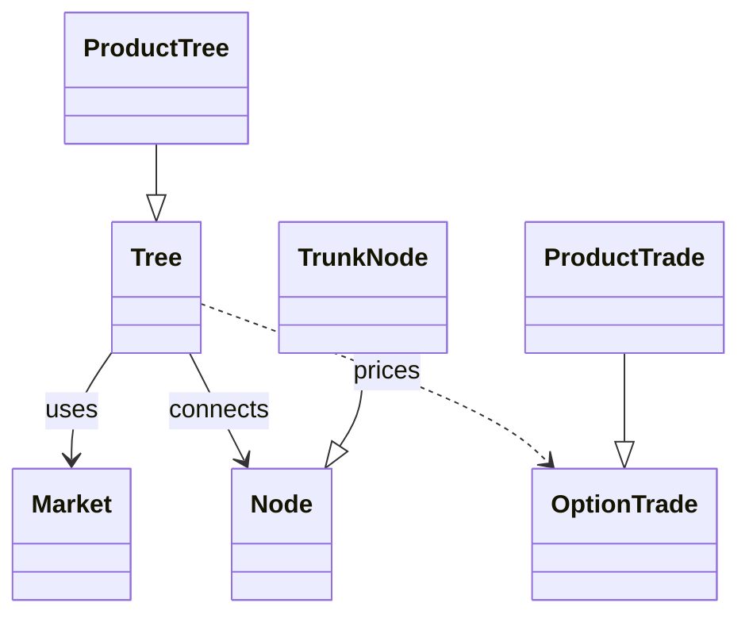
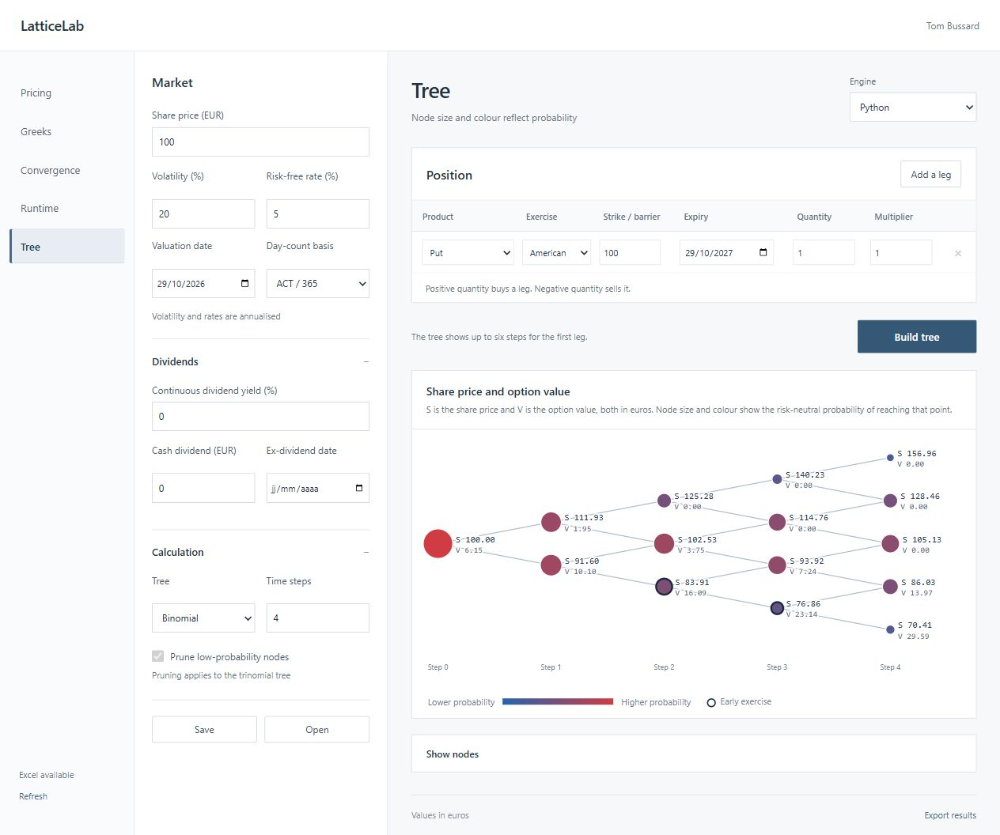
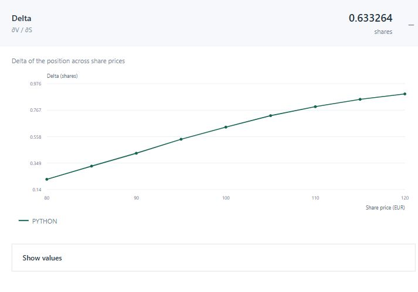
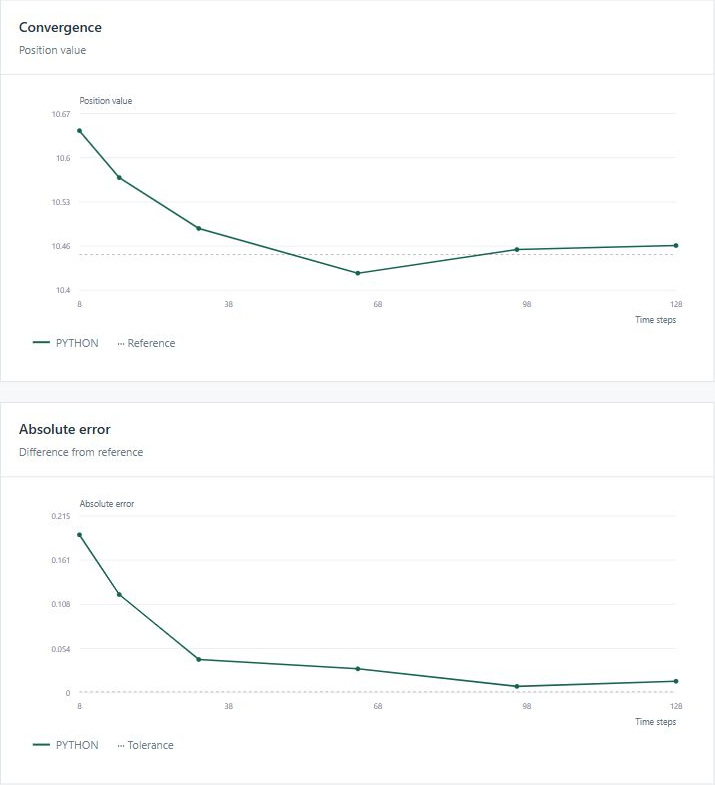
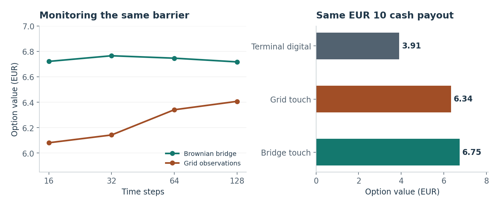

# LatticeLab

LatticeLab is an equity derivatives workbench I built in Python and Excel VBA. I use recombining trees to price portfolios of vanilla, digital, barrier and custom payoffs, trace an exercise or barrier decision to individual nodes, and compare sensitivities, numerical error and runtime across implementations.

## Pricing workbench

I use the same workbench to define a payoff, build a position, inspect individual nodes and compare numerical methods. The Python engine runs locally. On Windows the interface can send the same trade to Excel VBA and show both sets of results.

| Task | What you can do |
| --- | --- |
| Build a contract | Choose a call, put, cash digital call or put, up one-touch, or enter a payoff in `S` and `K`. Vanilla and custom contracts offer European or American exercise. The one-touch has grid and continuous monitoring. |
| Build a position | Add legs with their own strike, expiry, signed quantity and multiplier. Change spot, volatility, rate, continuous dividend yield, one dated cash dividend and the ACT/365 or ACT/360 day count. |
| Inspect risk | Read unit and position values, the initial share hedge and nine price sensitivities. Select a Greek to reprice the position across nine spot levels. |
| Inspect the numerics | Switch between two- and three-branch trees, adjust trinomial pruning, and inspect the first leg's nodes on a grid of up to 12 steps. The convergence and runtime views accept much larger grids. |
| Repeat a run | Save and reopen the contract settings as JSON, export the results or run the two implementations side by side. |

Start with the [up one-touch](examples/up-one-touch.json) to study a barrier between dates, or the [call spread](examples/call-spread.json) to see how two signed legs combine. The [American put](examples/american-put.json) and [European call](examples/european-call.json) below isolate exercise and grid accuracy.

## Object-oriented design of the lattice

One of my goals was to implement the numerical method as a set of objects with distinct jobs. A `Market` holds the spot, rates, volatility and dividend assumptions. A `Node` holds a spot, links to its successors, the transition probabilities, its probability of being reached and the option value calculated during induction. `TrunkNode` adds the links used to walk from one time slice to the next. A `Tree` builds those objects from the market and can price more than one contract on the same geometry.



The split matters during backward induction. `OptionTrade.payoff` supplies a vanilla terminal payoff and `node_value` decides whether early exercise is allowed. `ProductTrade` specialises the payoff for digitals and custom expressions. The up one-touch needs one extra piece of behaviour between dates. `ProductTree` specialises the node valuation for that case and delegates ordinary contracts to the base tree. The binomial and trinomial grids are two configurations of the same tree class. [Market](python/engine/core/market.py) · [Node and TrunkNode](python/engine/core/node.py) · [Tree](python/engine/core/tree.py) · [Base contract](python/engine/core/option_trade.py) · [Product specialisations](python/engine/products.py)

For the two-call spread, the pricing service creates two trade objects and builds one tree for their shared expiry. It reads the root value for the first call, runs induction again with the second payoff and combines the signed values. Bump scenarios use the same pricing entry point. In VBA, `Valuator` creates `Market`, `OptionTrade` and `Tree` objects, while `BatchValuator` handles batches for the workbook interface. That structure lets me compare the Python and VBA prices leg by leg. [Python position pricing](python/engine/pricing.py) · [VBA valuation](vba/Valuator.cls) · [VBA batch valuation](vba/BatchValuator.cls)

## Inside the pricer

Both examples use a share price and strike of **€100**, one year to expiry, **20%** annual volatility, a continuously compounded **5%** interest rate and no dividends. Each position is long one option on one share. The interface can also price contracts with a continuous dividend yield or one dated cash dividend.

### When is it worth exercising the put?

I started with a four-step American put so I could check each decision by hand. In the diagram, **S** is the share price and **V** is the put value. A darker outline marks a node where the holder exercises before expiry. The colour and size of each node show the risk-neutral probability of reaching it.



I build each step around the share's forward value. Let $S$ be the current share price, $r$ the interest rate, $q$ the continuous dividend yield, $\sigma$ the volatility and $\Delta t$ the step length in years. For a binomial step with no cash dividend, I choose the larger solution $a>1$ below to match the one-step variance.

```math
F=S e^{(r-q)\Delta t}, \qquad a+a^{-1}=1+e^{\sigma^2\Delta t}
```

```math
S_u=Fa,\qquad S_d=F/a,\qquad p_u=\frac{1}{1+a}
```

From €100, a quarter-year step gives **€111.93** with probability **47.50%** and **€91.60** with probability **52.50%**. Their probability-weighted mean is the forward value, €101.26. Up-then-down and down-then-up meet at the same node, so both paths use the same exercise decision. [Branch construction](python/engine/core/tree.py)

| Decision | Share price | Exercise proceeds | Discounted value of waiting | Put value |
| --- | ---: | ---: | ---: | ---: |
| Today | €100.00 | €0.00 | €6.15 | €6.15 |
| After two down moves | €83.91 | €16.09 | €15.39 | €16.09 |

At expiry the put pays $V_T=\max(K-S_T,0)$ for strike $K$. At every earlier node I compare the proceeds from exercising with the discounted value of its two children.

```math
C=e^{-r\Delta t}\bigl[p_u V_u+(1-p_u)V_d\bigr],\qquad V=\max(K-S,C)
```

After two down moves, exercising is worth **€0.70 more** than waiting. Today the opposite decision wins. Carrying the child values back to the root gives **€6.1520**. To follow the same calculation in the app, open the example, choose **Tree**, click **Build tree** and expand **Show nodes**. [Four-step put inputs](examples/american-put.json)

### What happens to the hedge as the share moves?

For the European call I used 128 binomial steps. To estimate delta, the **Greeks** view prices the same contract twice, shifting the spot by $h$ in each direction.

```math
\Delta(S)\approx\frac{V(S+h)-V(S-h)}{2h}
```

At a spot of €100 the default bump is €2. The call is worth €9.21644 at €98 and €11.74949 at €102. Dividing the difference by €4 gives **0.6333 shares**. Expanding **Delta** repeats the calculation across nine spots with the strike, expiry, rate and volatility fixed. [Finite-difference calculation](python/engine/derivatives.py)



| Share price | €80 | €100 | €120 |
| --- | ---: | ---: | ---: |
| Call delta in shares | 0.2213 | 0.6333 | 0.8954 |

At the strike, one long call has roughly the same exposure to a small move as **0.63 shares**. A short position in that many shares offsets its initial delta. At €120 the hedge is closer to **0.90 shares**. Open the call example, choose **Greeks**, click **Calculate Greeks** and expand **Delta** to reproduce the curve. [128-step call inputs](examples/european-call.json)

### How fine does the grid need to be?

The European call has an analytical Black-Scholes price of **€10.450584**. Under **Convergence**, the app prices it on six grids and plots both the price and the absolute error. The dashed line in the lower panel marks the requested tolerance of €0.001.



| Time steps | Binomial price | Absolute error |
| ---: | ---: | ---: |
| 8 | €10.642637 | €0.192054 |
| 32 | €10.490958 | €0.040374 |
| 64 | €10.421614 | €0.028970 |
| 96 | €10.458204 | €0.007621 |
| 128 | €10.464454 | €0.013870 |

The 64-step tree crosses below the reference, and the error at 128 steps is larger than at 96. None of these six grids reaches the requested tolerance. For comparison, the separate figure below runs both tree methods at ten grid sizes on the same market assumptions.


## Digital cash or cash at first touch?

I set the spot to €100, the barrier and digital strike to €110, and the cash payout $B$ to €10. The expiry is one year away. The digital observes the final share price. The one-touch observes the path and pays when it first reaches the barrier. That difference matters even though the cash amount and price level are identical.

```math
V_{\mathrm{dig,call}}=e^{-rT}B\,\mathbb{Q}(S_T\ge K),\qquad
V_{\mathrm{dig,put}}=e^{-rT}B\,\mathbb{Q}(S_T<K)
```

With grid monitoring, the one-touch sees only tree dates. For continuous monitoring I use a Brownian bridge. If both endpoints $x,y$ are below $H$ and there is no cash dividend during the step, the conditional probability of an intervening touch is

```math
h(x,y)=\exp\!\left(-\frac{2\log(H/x)\log(H/y)}{\sigma^2\Delta t}\right).
```

A child at or above the barrier has hit probability one. From an unhit node I discount a hit payment to the middle of the step and an unhit continuation to the next date. With branch probabilities $p_j$ and $h_j=h(x,y_j)$, the implemented approximation is

```math
V_i=\sum_j p_j\left[h_j B e^{-r\Delta t/2}+(1-h_j)e^{-r\Delta t}V_j\right].
```

| One-year contract | 64-step value in EUR |
| --- | ---: |
| Cash digital call, observed at expiry | 3.90857 |
| Cash digital put, observed at expiry | 5.60372 |
| Up one-touch, observed at grid dates | 6.34097 |
| Up one-touch, bridge monitoring | 6.74700 |

The two digitals sum to **€9.51229**, the present value of a certain €10 at expiry. The bridge adds **€0.40603** to the grid-monitored touch because a path can cross €110 and fall back before the next observation. Desktop Excel reproduced both one-touch values to better than €0.00000001. [Payoffs and bridge recursion](python/engine/products.py) · [Open the barrier contract](examples/up-one-touch.json)



## A portfolio of payoffs and nine Greeks

A position has signed quantities $q_j$, multipliers $m_j$ and unit prices $v_j$. The engine prices each leg on its own expiry and can reuse a lattice for legs with the same maturity. It then bumps the whole position, so the displayed Greeks include both long and short exposure.

```math
V=\sum_j q_jm_j v_j,\qquad
\Pi_T=(S_T-100)^+-(S_T-110)^+=\min\bigl((S_T-100)^+,10\bigr).
```

The second expression is the payoff of the saved call spread. The same payoff can be entered as `min(max(S-K,0),10)` with strike 100 in the custom-payoff editor. On the 64-step grid the long call contributes **€10.42161**, the short call **−€6.03094**, and the spread is **€4.39067**. The initial equity hedge is **−0.1832 shares** per spread. Excel reproduces the spread value on the same inputs. [Spread configuration](examples/call-spread.json) · [Position pricing](python/engine/pricing.py)

| Sensitivities | What changes in the calculation |
| --- | --- |
| Delta, gamma, speed | First, second and third derivatives with respect to spot. Gamma measures how the hedge moves, and speed measures how gamma moves. |
| Vega, volga, vanna | Sensitivity to volatility, curvature in volatility, and the change in delta as volatility moves. Vega and vanna are per volatility point, volga per squared point. |
| Theta, charm, rho | Move the valuation date for theta and charm, keeping the expiry fixed. Bump the interest rate for rho. The display uses elapsed days and rate points. |

For example, gamma uses three spot valuations and vanna uses a joint spot and volatility bump. Writing $h$ for a spot bump and $k$ for a volatility bump in decimal units gives the raw derivatives

```math
\Gamma\approx\frac{V(S+h)-2V(S)+V(S-h)}{h^2}.
```

```math
\mathrm{Vanna}\approx\frac{V(S+h,\sigma+k)-V(S+h,\sigma-k)-V(S-h,\sigma+k)+V(S-h,\sigma-k)}{4hk}.
```

On the saved spread the displayed vega is **−€0.03045 per volatility point** and vanna is **−0.01206 shares per point** at the initial spot. The two long and short contributions can produce a different net sign from either call's individual vega. The engine caches repeated bump valuations. I check grid sensitivity before interpreting higher derivatives, especially near digital strikes. [Derivative stencils and units](python/engine/derivatives.py)

## Three branches and a dated dividend

The trinomial lattice places three children at $F/\alpha,F,F\alpha$ on an ordinary step, where $F=S e^{(r-q)\Delta t}$ and $\alpha=e^{\sigma\sqrt{3\Delta t}}$. I choose probabilities by matching the conditional mean and variance as well as total probability.

```math
\sum_j p_j=1,\qquad \sum_j p_jS_j=F,\qquad
\sum_j p_j(S_j-F)^2=F^2\!\left(e^{\sigma^2\Delta t}-1\right).
```

In the four-step market above the first down, middle and up branches have probabilities **18.15%, 66.58% and 15.27%**. Optional pruning sends the probability of a very unlikely node to a central child. The runtime view times tree construction and backward induction separately and reports the median of two runs per grid.

A cash dividend changes the forward on the step containing its ex-date. If $\delta$ is the time from that date to the end of the step and $D$ is the cash amount, the target becomes

```math
F_D=S e^{(r-q)\Delta t}-D e^{(r-q)\delta}.
```

The engine recentres the branch and matches the adjusted price moments on that step, including when the surrounding tree is binomial. In the one-year €100 call, a **€2** cash dividend on 29 April, about halfway to expiry, changes the 64-step price from **€10.42161 to €9.31597**. The convergence view uses an analytical reference for eligible European vanilla positions. For other contracts it uses a finer Python tree and labels that reference as numerical. [Tree construction and dividend moments](python/engine/core/tree.py) · [Convergence and timing](python/analyses.py)

## How it works

The input layer normalises dates, day count, dividend schedules and signed positions. The pricing layer builds a recombining lattice, assigns option payoffs at expiry and works back through the tree. The analysis routines reuse those engines for prices, Greeks, tree inspection and convergence. The Excel bridge passes the same inputs to the workbook. [Inputs](python/engine/inputs.py) · [Tree construction](python/engine/core/tree.py) · [Pricing](python/engine/pricing.py) · [Analysis](python/analyses.py) · [Excel bridge](python/excel_bridge.py)

I checked the implementations separately from grid accuracy. For the 32-step European call the Python prices are **€10.490958** for the binomial tree and **€10.445273** for the trinomial tree. Desktop Excel agreed with Python to within **€0.000000000001** for both prices. The differences from Black-Scholes at this grid size are still visible.

## Run locally

From the repository root, start the local interface with Python 3.10 or later.

```sh
python python/server.py
```

In the **Market** sidebar, click **Open** and select any of the four JSON files in the `examples` directory. The Python engine runs offline with the standard library. To print the ten-grid comparison directly, run `python python/convergence_example.py`.

For a side-by-side comparison, use desktop Excel on Windows, install the bridge with `python -m pip install -r requirements.txt`, then select **Python and VBA** in the app. [Excel workbook](vba/Pricer.xlsm) · [Exported VBA modules](vba)

Tom Bussard
